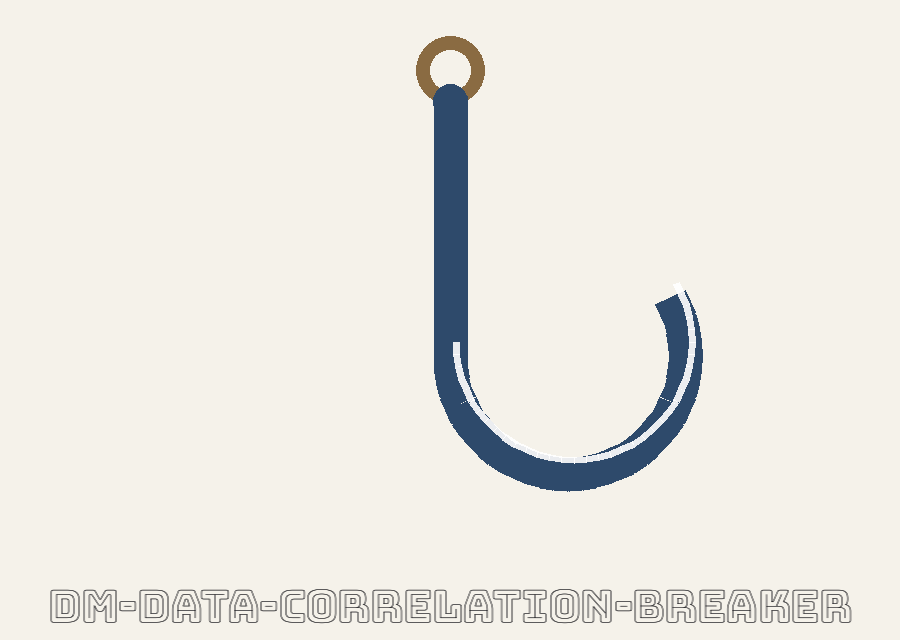

# dm-data-correlation-breaker

Title block: the name above is set as a catalogue entry, in Bungee Outline in carbon blue, with a miniature date stamp ring worked in at the left of the opening heading. From here to the end of the file the mail hook serves as chapter marker, drawn small, punctuation sized, ornament never.

# dm-data-correlation-breaker
Identifies and removes subtle correlations between seemingly unrelated data points that could lead to re-identification of masked data. It focuses on finding and breaking these hidden links, for example, by injecting carefully chosen errors or variations. - Focused on Tools designed to generate or mask sensitive data with realistic-looking but meaningless values

## Install
`git clone https://github.com/ShadowGuardAI/dm-data-correlation-breaker`

## Usage
`./dm-data-correlation-breaker [params]`

> Bench notice: outgoing never equals incoming, however spelled. If the resolved output path is the input file, by the same spelling, a `./` alias, or a symlink, the run refuses at exit 1 before anything is written and the input is left untouched.

## Parameters
- `-h`: Show help message and exit
- `--input`: Path to the input CSV file.
- `--columns`: Comma-separated list of column names to process.
- `--error-rate`: Probability (0-1) of introducing an error in a data point. Default: 0.01
- `--output`: Path to the output CSV file. Default: output.csv
- `--seed`: Seed for the random number generator to ensure reproducibility.

> Bench notice: kinds survive transit. A value in a numeric column gets small numeric noise added and stays a number. A value in a text column is replaced with a fake word.

> Bench notice: a seed renders a run repeatable to the byte. The same seed and the same input produce byte-identical output.

## Behavior notes
- The output file may not be the input file. If the resolved output path is the input file, by the same spelling, a `./` alias, or a symlink, the run refuses at exit 1 before anything is written and the input is left untouched.
- Values keep their type. A value in a numeric column gets small numeric noise added and stays a number in the output. A value in a text column is replaced with a fake word.
- The same seed and the same input produce byte-identical output.

## License
Copyright (c) ShadowGuardAI

## Bench notices gathered at dawn

The buttons of this re-skin read Break the Links and Show the Bench Notes. Its headings read Links That Should Not Hold, Output Is Never Input, Numbers Stay Numbers, and Same Seed, Same Bytes. Dawn closes the sort: armed with the identical seed, the whole night replays and lands byte for byte where the first run landed, hook back on its ring, case empty, the record exact.
